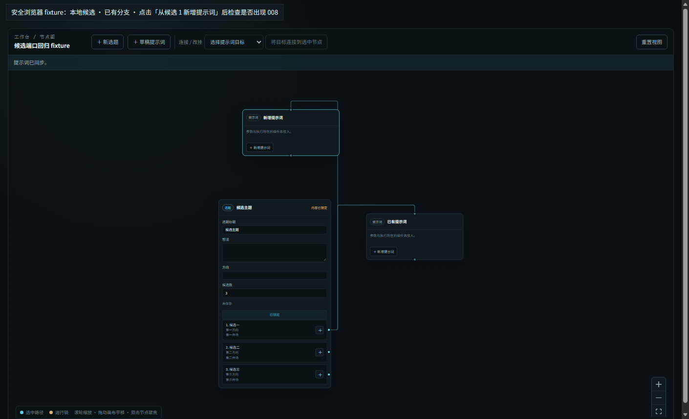

# 画布错误 008：动态候选端口与派生边同步

| 项目 | 结果 |
|---|---|
| 状态 | 实现与自检完成，待用户评审；不代表 M2-10B 或 M2 整体验收 |
| 范围 | 已应用 topic 候选端口、工程图刷新、React Flow 派生边的前端时序 |
| 风险操作 | 未修改工程数据；未调用真实 Agent/CLI；未自动化驱动 Wails 桌面窗口 |

## 问题与修复

错误 `008` 表示 React Flow 计算边位置时，找不到该边指定的来源/目标 handle。动态读取已应用候选时，候选 handle 会加入或移出节点；此前候选读取又会随普通图 revision 刷新而清空。节点通过 React state 同步、边则由新模型单独派生，可能短暂引用 DOM/内部测量尚未就绪的 handle。

修复包括：

- 候选读取按工程、topic 和最新已应用 topics 轮次的 artifact 标识维护；普通图 revision 更新不清空已读取候选。新轮次重新读取，旧工程/旧轮次的迟到响应被丢弃；读取失败保持可见错误，并在后续图 revision 时重试。
- 连线从当前实际渲染的节点状态派生。节点端口布局变化时调用 React Flow `useUpdateNodeInternals`；在来源和目标节点都报告该布局已测量前，暂不提交相应边给 React Flow 渲染。工程图中的父子关系始终不变，也不因等待而重发 Connect。
- Topic 与 Prompt 节点均纳入 handle 测量，覆盖 topic 候选/占位锚点变化和 prompt 输出端口出现。

## 自动化验证

从 `AudioUI/` 运行：

| 命令 | 结果 |
|---|---|
| `npm --prefix frontend run test -- src/canvas/flowModel.test.ts src/canvas/CanvasNodes.test.tsx src/canvas/WorkspaceCanvas.test.tsx src/canvas/WorkspaceCanvas.realFlow.test.tsx` | 4 个测试文件、30 项通过 |
| `npm --prefix frontend run test` | 16 个测试文件、102 项通过 |
| `npm --prefix frontend run typecheck` | 通过 |
| `npm --prefix frontend run lint` | 通过 |
| `npm --prefix frontend run check:tokens` | 通过 |
| `npm --prefix frontend run build` | 通过；JS gzip 161.46 kB。Vite 提示单个未压缩 JS chunk 约 515.69 kB，超过默认 500 kB 提示线 |
| `git diff --check` | 通过；Git 对工作区内其他既有修改输出换行格式提示 |

新增 React Flow 回归覆盖：候选 handle 异步从占位端口切换、边等待端口测量、候选加载完成后绘制已保存连接、无关图 revision 更新不重新读取候选，以及源/目标任一端口未测量时保持边隐藏。

## 浏览器验证

使用本地 Edge headless 和安全 fixture，实际挂载 `WorkspaceCanvas` 与未 mock 的 React Flow；候选与 GraphAPI 使用本地固定数据，不连接后端服务。

- Viewport：`1410 × 858`。
- 操作：等待已应用候选端口出现，点击“从候选 1 新增提示词”，等待工程快照 fixture 更新。
- 结果：3 个节点、2 条 SVG 边；新增边与已存在边均可见；画布无 `008` 错误；浏览器控制台错误和 HTTP 失败请求均为 0。
- 截图：

实际 AudioUI Vite 根页面也在浏览器打开，但没有 Wails 注入的后端服务，因此呈现“环境检查失败 / 工作台加载失败”；这不是桌面端验收。测试结束后已删除临时 fixture 源文件，截图保留作为证据。

## 未覆盖

- Wails/WebView2 窗口中的专有测量、缩放与桌面呈现；按项目约束未自动化驱动桌面窗口。
- 真实 Agent/CLI、真实 `GetTopicCandidates` 后端调用、真实工程重启后的 GUI 验收。
- AC-04/AC-M2-12 中提示词运行上下文与不同候选真实执行；本次仅验证连接渲染，不宣称这些验收通过。
