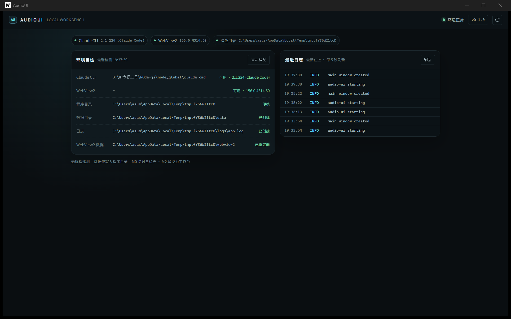
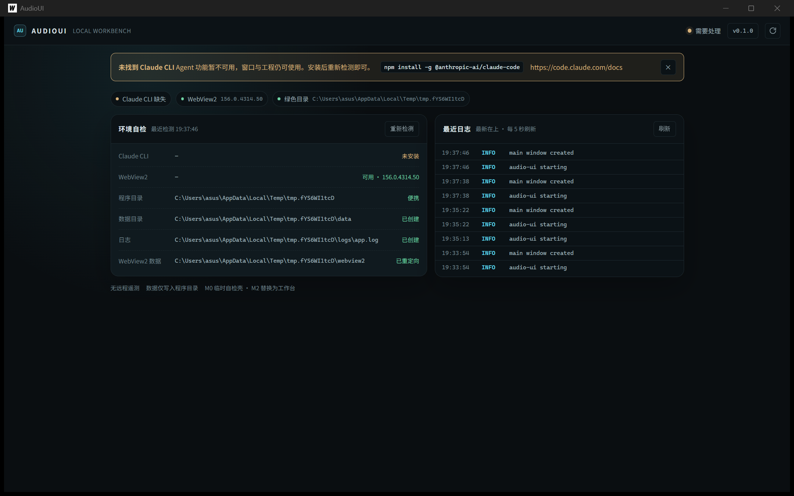

# M0 验收证据

| 项 | 内容 |
|---|---|
| 日期 | 2026-10-31 |
| 版本 | 0.1.0 |
| 产品名 | AudioUI（原名 Bili Studio） |
| 环境 | Windows 11 25H2（Build 26200）· Go 1.27.3 · Wails v3.0.0 · WebView2 156.0.4314.50 · Claude Code 2.1.224 |
| 状态 | 用户已验收；M0 已完成 |

## 1. 自动化结果

| 检查 | 命令 | 结果 |
|---|---|---|
| 格式 | `gofmt -l main.go internal version_test.go` | 无输出 |
| 静态检查 | `go vet . ./internal/...` | 通过 |
| Go 测试 | `go test . ./internal/...` | 全部通过 |
| 版本一致性 | `TestVersionSourcesAgree` | 通过（VERSION/config/info/package/CHANGELOG 均为 0.1.0） |
| 前端类型 | `npm --prefix frontend run typecheck` | 通过 |
| 前端规范 | `npm --prefix frontend run lint` | 通过 |
| 令牌检查 | `npm --prefix frontend run check:tokens` | 通过 |
| 前端构建 | `npm --prefix frontend run build` | 通过；JS 79.84 KB gzip |
| 生产构建 | `wails3 build` | 通过，产物 `bin/audio-ui.exe` |
| 版本输出 | `bin/audio-ui.exe --version` | `AudioUI v0.1.0` |
| 便携自检 | 临时目录运行 `--self-check` | 退出码 0；三目录创建；CLI/WebView2 可用；报告写入 `logs/self-check.json` |
| CLI 缺失 | 限制 PATH 后 `--self-check` | 退出码 0；`cli.installed=false`；安装提示存在 |
| 错误自检 | 无效 `AUDIOUI_HOME` + `--self-check` | 立即退出 1，stderr 输出错误，不弹模态框 |

## 2. 独立复核与修复

子 agent 对 M0 做了独立测试与源码分析，未发现 blocker/critical；发现两个 major 与若干 minor，已修复：

- Claude CLI 超时未终止子进程树 → 新增 `cmd.WaitDelay`、Windows `taskkill /T /F` 取消函数；假 CLI 自检从 7.4s 降到约 3s。
- `--self-check` 在启动错误时弹原生 MessageBox → 无界面模式改为 stderr + 退出码 1。
- WebView2 检测拒绝 `0.0.0.0`、要求 `msedgewebview2.exe`、按数值比较版本、避免空根路径。
- 日志 tail 丢弃未写完的尾行，避免面板显示半截 JSON。
- CLI 版本检测失败时 UI 显示警告；刷新错误可见；日志列表使用稳定 key。
- Wails 版本改为从 build info 读取；版本 fallback 不再硬编码 0.1.0。
- 绑定生成命令统一为 `-ts -i`；构建后恢复 `frontend/dist/.gitkeep`。
- 单实例焦点竞态改为 `ApplicationStarted` 事件后处理。

## 3. GUI 冒烟（重命名后）

在临时目录复制 exe 后启动，未使用开发覆盖：

- 窗口标题与品牌均为 `AudioUI`，默认 1440×900 DIP。
- 同级生成 `data/`、`logs/`、`webview2/`。
- 日志包含 `audio-ui starting`、`main window created`。
- 第二次启动进程立即退出（exit code 0），运行中进程数保持 1。
- 通过限制 PATH 启动，CLI 缺失横幅出现，窗口不崩溃。
- 检查 `%APPDATA%` 与 `%LOCALAPPDATA%` 下 AudioUI/audio-ui/com.audioui.desktop 目录均不存在。
- 关于弹窗在重命名前的同一实现中打开验证；重命名后代码路径未变，版本由 `--version` 与一致性测试覆盖。

截图：

## 4. AC 映射

| 验收 | 证据 | 结论 |
|---|---|---|
| AC-M0-1 | 窗口截图；AppData 目录检查均为 False；WebView2 数据在 exe 同级 | 通过 |
| AC-M0-2 | 截图与 `--self-check` 报告中的三目录 | 通过 |
| AC-M0-3 | CLI 缺失截图；进程正常；横幅含安装命令 | 通过 |
| AC-M0-4 | 二次启动退出码 0；进程数 1；单实例回调聚焦 | 通过（焦点行为需目视确认） |
| AC-M0-5 | `--version`、版本一致性测试、关于弹窗实现 | 通过 |
| AC-14 | `logs/app.log`、最近日志面板、zap JSON | 通过 |

## 5. 未覆盖 / 已知限制

- 干净 Windows 用户配置下的手工验收需用户完成；本机是开发机。
- 只读目录 ACL 场景未在真实受限目录验证；已用「目录被文件占用」单测覆盖错误路径。
- WebView2 缺失提示无法在本机卸载验证；检测代码与自检报告已覆盖。
- 生产包以 `-H windowsgui` 隐藏控制台；`--version` 在 Git Bash 下可读取，双击以 GUI 为准。
- 应用图标仍为 Wails 默认占位，品牌图标留到后续视觉批次。
- `npm audit` 的 12 个 moderate 仅存在于 ESLint/minimatch 等开发依赖；`npm audit --omit=dev` 为 0。
- 前端尚无自动化测试；轮询、错误态与对话框留到后续测试批次。
