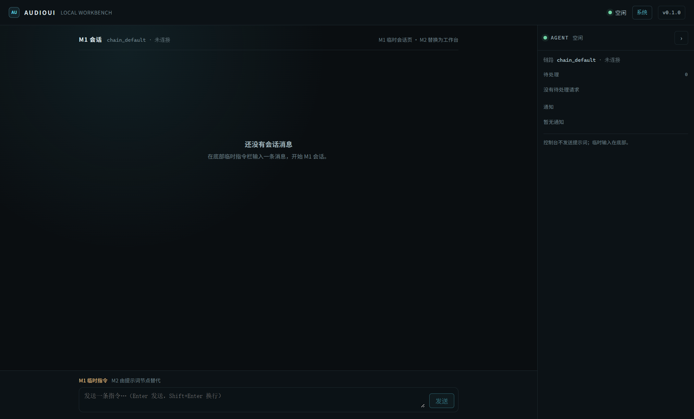
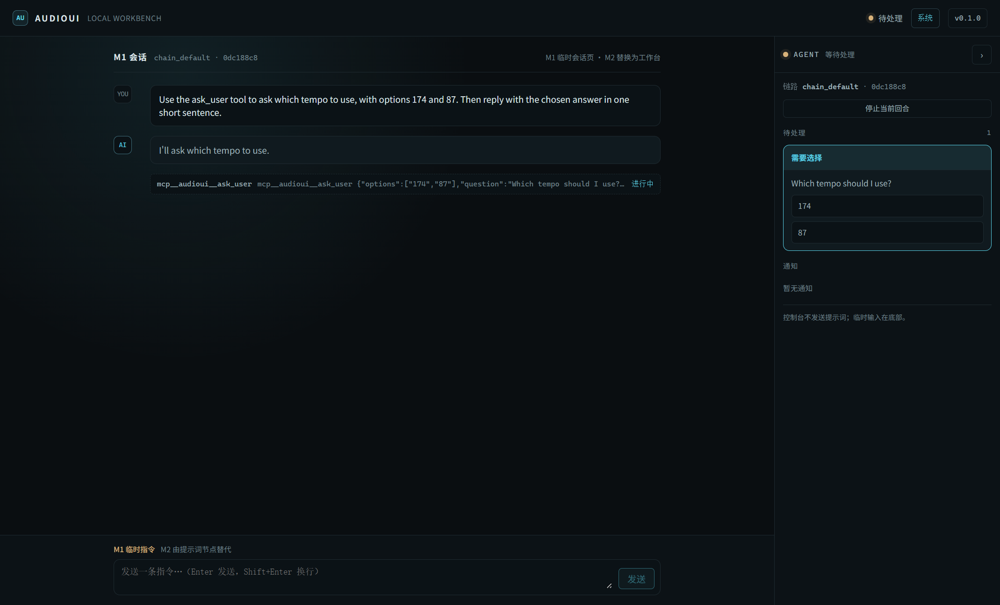
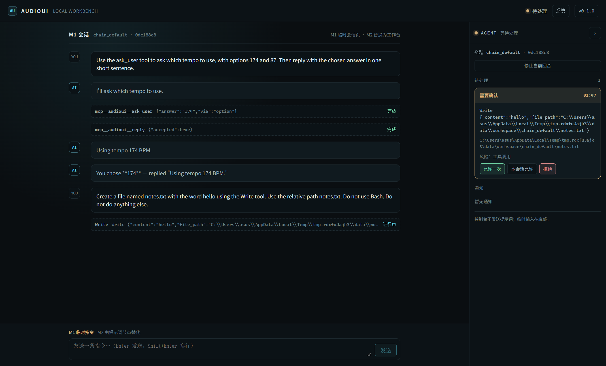
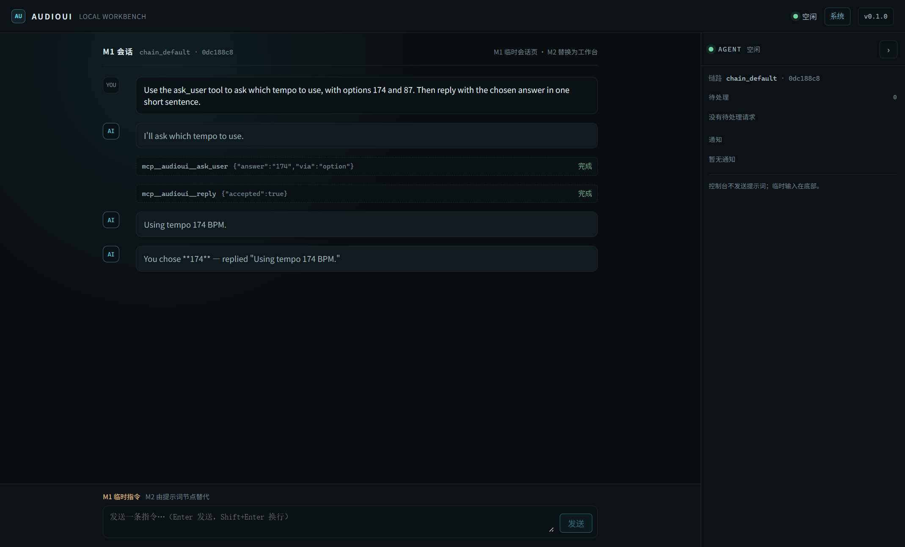
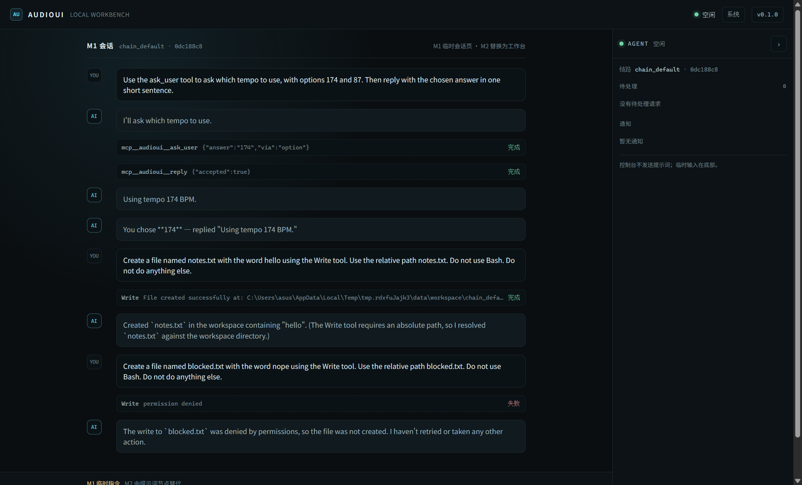
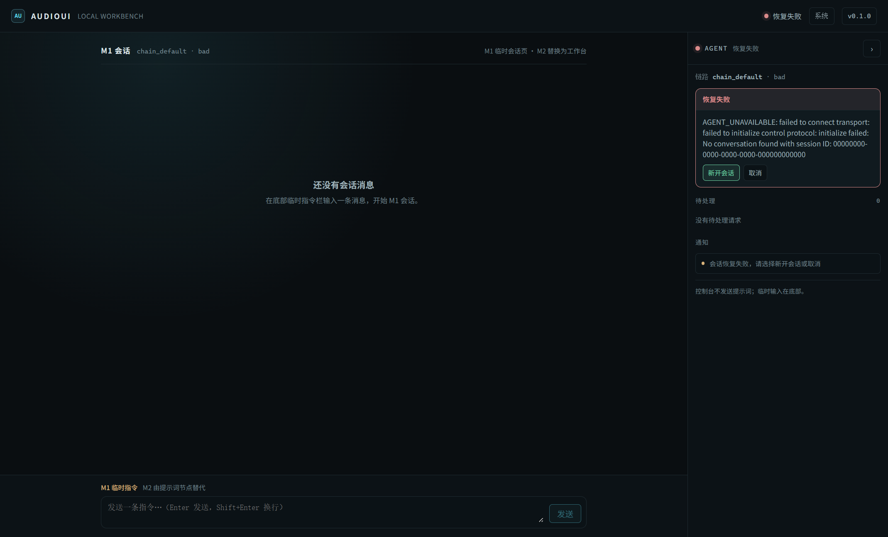

# M1 验收证据

| 项 | 内容 |
|---|---|
| 日期 | 2026-11-01 |
| 版本 | 0.2.0（M1 验收通过，收口版本） |
| 环境 | Windows 11 25H2（Build 26200）· Go 1.27.3 · Wails v3.0.0 · WebView2 156.0.4314.50 · Claude Code 2.1.224 |
| 依赖 | `github.com/severity1/claude-agent-sdk-go v0.10.0` · `github.com/modelcontextprotocol/go-sdk v1.8.0` |
| Agent profile | 复用现有 `~/.claude`；`--setting-sources=user` 加载用户级配置；应用数据/日志/workspace 在 exe 目录 |
| 状态 | 验收通过（2026-11-01，用户确认），收口 0.2.0 |

## 1. 自动化结果

| 检查 | 命令 | 结果 |
|---|---|---|
| 格式 | `gofmt -l main.go internal version_test.go` | 无输出 |
| Go 静态检查 | `go vet . ./internal/...` | 通过 |
| Go 测试 | `go test . ./internal/...` | 通过 |
| 路径 guard | `go test ./internal/infra/paths` | 通过：相对/绝对 workspace、越界、UNC、runtime/artifacts、junction |
| 权限/审计 | `go test ./internal/service/permission` | 通过：三档、Bash 路径/写选项、120s 超时、审计失败 fail-closed、allow-session 作用域、问题超时 |
| 会话状态 | `go test ./internal/service/session` | 通过：发送、第二轮 seq、忙/关闭/resume 失败拒绝、问题与权限回传、新开会话、陈旧事件忽略、流式合并、200 条截断、损坏元数据 |
| MCP | `go test ./internal/infra/agent/mcp` | 通过：401、工具列表、7 个工具入参校验、路径拒绝、grep 受保护目录、ask_user、配置写入、行截断 |
| agent host | `go test ./internal/agenthost` | 通过：环境过滤、缺少原生路径退出码 2、host 模式判定 |
| Wails 绑定 | `go test ./internal/handler` | 通过：空消息/非法权限决定/空回答校验、会话错误映射、状态默认值 |
| 持久化 | `go test ./internal/infra/persistence` | 通过：原子读写、损坏文件、BOM |
| 前端类型 | `npm --prefix frontend run typecheck` | 通过 |
| 前端规范 | `npm --prefix frontend run lint` | 通过 |
| 令牌检查 | `npm --prefix frontend run check:tokens` | 通过 |
| 前端测试 | `npm --prefix frontend run test` | 6 个文件 / 21 个用例通过 |
| 前端构建 | `npm --prefix frontend run build` | 通过；JS 约 83 KB gzip |
| 协议回放 | `TestStreamEventReplay` | 通过：stream delta 共享消息 ID |
| 事件映射 | `go test ./internal/infra/agent/claudecli` | 通过：增量分组、工具行合并、结果事件、resume ref、stderr 脱敏、UTF-8 安全截断 |
| 原生 CLI 解析 | `go test ./internal/infra/agent/claudecli` | 通过：npm shim 解析、shim 内绝对路径、拒绝 `.cmd` |
| 生产构建 | `wails3 build` | 通过，产物 `bin/audio-ui.exe` |

### 1.1 最终构建复验

收口前的最后一批代码修改（原生 CLI 解析、凭据加载、按字符截断、MCP 版本注入）晚于首次截图，因此重新构建并复验：

| 检查 | 结果 |
|---|---|
| `gofmt -l main.go internal version_test.go` | 无输出 |
| `go vet . ./internal/...` | 通过 |
| `go test . ./internal/...` | 通过 |
| `npm --prefix frontend run typecheck / lint / check:tokens / test / build` | 通过（6 文件 / 21 用例） |
| `wails3 build` | 通过 |
| `bin/audio-ui.exe --version` | `AudioUI v0.2.0` |
| `bin/audio-ui.exe --self-check`（临时目录） | `ok: true`，`version: 0.2.0`；`data/logs/webview2` 创建；CLI 2.1.224、WebView2 156.0.4314.50 检测正常 |
| 启动冒烟 | 窗口创建成功；日志无 `claude native cli unavailable`，原生 `claude.exe` 解析成功 |
| 凭据加载（干净环境） | 清空全部 `ANTHROPIC_*` / `CLAUDE_CODE_*` 后跑 `TestLiveSDKSpike`、`TestLiveHostMCPAskUser`：通过；仅凭 `~/.claude/settings.json` 完成鉴权，等价于资源管理器双击启动 |

截图取自同一 UI 的调试构建，界面与最终构建一致；上述复验针对最终构建产物。

## 2. 真实 CLI 集成结果（opt-in）

以下测试需 `AUDIOUI_LIVE_CLI=1`，使用本机原生 Claude CLI 与真实登录：

| 测试 | 结果 |
|---|---|
| `TestLiveSDKSpike` | SDK 连接、stream-json 增量、Write 权限回调通过；工作区未写入 |
| `TestLiveHostMCPAskUser` | agent host 转发、HTTP MCP、`ask_user`、工具结果、`reply` 通过 |
| `TestLiveWritePermission` | PreToolUse 后进入 CanUseTool；拒绝 Write 后文件未创建 |
| `TestLiveResumeWithNewMCPToken` | 关闭后换新 MCP token/端口 resume，上下文保留（ORANGE） |

## 3. GUI 冒烟

- 初始页面：M1 临时会话页、右侧控制台、底部 PromptDock；Agent 空闲。
- 发送消息后：用户消息立即出现；Agent 流式文本与工具行逐步出现。
- `ask_user`：QuestionCard 出现；选择 174 后工具返回 `{"answer":"174","via":"option"}`，Agent 继续回复。
- 权限：Write 触发 PermissionCard；允许一次后 `notes.txt` 创建；拒绝后 `blocked.txt` 未创建；`logs/audit.log` 记录 auto_allow / allow / deny，包含 session_id 与路径。
- 重启：关闭再启动，自动 resume；本地 transcript 恢复，Agent 能继续上下文。
- 恢复失败：无效 session ID 启动时显示 ResumeFailureCard（新开会话/取消），不自动新开。
- 新开会话：点击后清空失败状态，进入空闲会话。
- 多轮：第一轮结束后再次发送，状态快照/用户消息/seq 正常应用，不再被旧 seq 丢弃。
- 单实例：主窗口保持单实例；agent host 是同 exe 的辅助进程（见限制）。

截图：

## 3.1 独立复核修复

子 agent 复核发现并已修复：

- Bash 路径逃逸与写选项：`~`、盘符、UNC、`..`、`runtime/artifacts`、`find -fprintf`、`git --output` 等拒绝或确认；Bash 不再提供跨会话允许。
- 事件序号：所有状态/权限/问题事件走同一单调 seq；快照带 seq；pending 权限/问题进入快照。
- 审计：改为直接文件写入并检查错误；允许决策审计失败 fail-closed；auto_allow/allow/deny 均记录。
- 路径：junction/reparse point 拒绝；MCP grep 跳过受保护目录、symlink 并逐文件 guard。
- 会话：allow-session 随 session 变化清空；resume/NewSession/Close 使用 generation 隔离；持久化串行化。
- 前端：IME 组合输入不提交；发送失败保留草稿；待处理状态显示。

## 3.2 收口修复

验收材料归档后又发现并修复：

| 缺陷 | 修复 |
|---|---|
| shim 内绝对 `claude.exe` 路径正则错误（`\[` 匹配字面量 `[`），绝对路径候选永不生效 | 改为 `\\`，补 `shimCandidates` / `ResolveNative` 三个测试 |
| GUI 双击启动要求登录：`--setting-sources=` 为空，cc-switch 写在 `~/.claude/settings.json` 的凭据到不了 CLI | 改为 `--setting-sources=user`，干净环境 live 测试验证；协议与 ADR 同步 |
| 工具摘要、stderr、grep 行按字节截断，中文被切成半个字符 | 改为按 rune 截断，补 UTF-8 边界测试 |
| `driver.go` 残留空 `init()`、`permissionPaths` 重复返回 | 删除死代码，简化签名 |

## 4. AC 映射

| 验收 | 证据 | 结论 |
|---|---|---|
| AC-M1-1 | 发送消息后流式 AI 文本与工具行；live SDK/MCP 测试 | 通过 |
| AC-M1-2 | Write 允许后文件存在；拒绝后文件不存在；audit allow/deny | 通过 |
| AC-M1-3 | 重启 UI 恢复 session 与本地 transcript；live resume 换 token | 通过 |
| AC-M1-4 | 无效 session 显示 ResumeFailureCard；新开会话可用 | 通过 |
| AC-M1-5 | ask_user QuestionCard；选项回传；超时单测 | 通过 |
| AC-06 | 流式、工具可见、权限可确认、问题可选择 | 通过 |
| AC-13 | 三档策略、越界硬拒绝、allow/deny 审计 | 通过（M1 为协作式策略门禁，不是 OS 沙箱） |

## 4.1 验收记录

| 项 | 内容 |
|---|---|
| 结论 | 通过（AC-M1-1..5、AC-06、AC-13） |
| 确认 | 用户确认收口，版本升至 0.2.0 |
| 日期 | 2026-11-01 |
| 遗留 | 干净 Windows 新用户、WebView2 缺失、只读 ACL 三项实机检查；不阻塞收口，见第 5 节 |

## 5. 已知限制 / 后续

- **Agent profile 例外**：默认复用 `~/.claude`，凭据/session 不在 exe；便携 profile 记 RM-014。
- **agent host**：主应用 + 同 exe 的 host 辅助进程；host 只转发 stdio 并托管原生 CLI，不是第二个工作台实例。
- M1 只有单链路、单在途回合；队列/并发 3 归 M5。
- 图谱工具、结构化 reply/待应用产物、fork、delete 未在 M1 暴露，按 M2/M5 计划。
- 完整历史回放/会话内 rewind 记 RM-015；M1 只保留最近 200 条 UI transcript。
- M1 权限是协作式策略门禁，不承诺 OS 级沙箱；M1 审计文件直接追加，未做轮转（M5 日志面板批次补）。
- 前端 npm 仍有 dev-only moderate 审计项；生产依赖为 0。
- 干净 Windows 新用户、真实 WebView2 缺失、只读 ACL 仍需用户手工验收。
